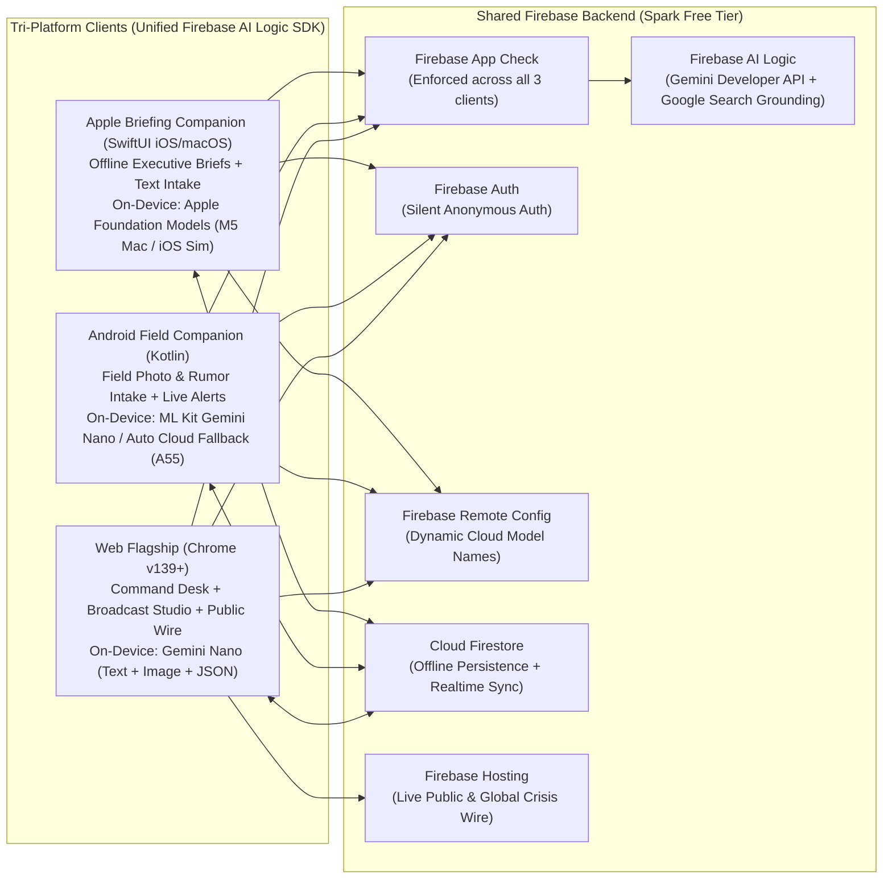

# SigapWire — Tri-Platform Hybrid AI Architecture

SigapWire is an independent open-source crisis communication and rumor-verification platform built for the **#BuildHybridAI 2026** hackathon using **Firebase AI Logic hybrid inference** across **Web (Chrome Desktop)**, **Android (Kotlin Compose)**, and **Apple (SwiftUI iOS / macOS)**.

> **Disclaimer:** SigapWire is an independent open-source project. All demo scenarios use synthetic or publicly available disaster preparedness examples and do not represent official government agency statements.

---

## 1. System Overview



---

## 2. Purposeful Hybrid Inference Routing Matrix

Every AI action intentionally chooses one of the four Firebase AI Logic inference behaviors rather than treating cloud solely as an error fallback:

| Workflow Step | Mode | Platform Runtime | Input -> Output | Why This Mode? |
| :--- | :--- | :--- | :--- | :--- |
| **1. Local Privacy Firewall (PII Redaction)** | `ONLY_ON_DEVICE` *(with explicit user consent banner if device lacks Nano)* | Web (Chrome Nano), Apple (Foundation Models), Flagship Android | Raw text -> Redacted text + redaction manifest (JSON) | Keeps victim names, phone numbers, and WhatsApp chat handles strictly off cloud servers; powers the live **"Stayed Local vs. Sent to Cloud" Diff**. |
| **2. Instant Intake Triage (`Field Report` / `Rumor Claim`)** | `PREFER_ON_DEVICE` | Web (Nano + PNG/JPEG), Android (ML Kit Nano -> auto Cloud fallback on Samsung A55), Apple (Apple Foundation Models text -> Cloud fallback) | Raw Indonesian/mixed text (+ optional single image on Web/Android) -> Structured JSON Card | Instant, zero-cost, offline-capable structuring during dead zones; mid-range devices (Samsung A55) automatically fall back to `gemini-3.5-flash-lite` without code branching. |
| **3. Live Rumor Verification (External Fact-Check)** | `ONLY_IN_CLOUD` + `{ googleSearch: {} }` | Cloud Gemini (`gemini-3.8-flash` / Remote Config) | Scrubbed claim only -> Verdict (`VERIFIED`, `MISLEADING`, `UNVERIFIED_DEVELOPING`), reasoning, clickable `groundingChunks`, and required `searchEntryPoint` widget | On-device models cannot search live news/BMKG/USGS feeds; cloud grounding provides verifiable citations and enforces honest `"UNVERIFIED_DEVELOPING"` handling. |
| **4. Multi-Report Synthesis & 4-Audience Broadcast Pack** | `ONLY_IN_CLOUD` (+ optional Search Grounding) | Cloud Gemini (`gemini-3.8-flash` or `gemini-4-hydrogen` via Remote Config) | Multiple synced `intakes` -> Synchronized Community Alert (ID), Media Press Release (ID), Global SitRep (EN), and Bilingual Debunk Card | Multi-report synthesis exceeds on-device 4k–9k token limits and benefits from stronger bilingual journalistic/humanitarian synthesis. |
| **5. Resilient Public Crisis Wire Reader Adaptation** | `PREFER_IN_CLOUD` | Web Public Wire & Apple Briefing Companion | Published dispatch -> Plain-language / 3-bullet executive / calm community adaptation (streaming) | Uses rich cloud model when online; seamlessly falls back to on-device Gemini Nano / Apple Foundation Models if reader connectivity drops mid-crisis. |

### Default Cloud Models (Overridable via Firebase Remote Config)
- `cloud_model_fast`: `gemini-3.5-flash-lite` *(hybrid fallback & low-latency structured tasks; Spark free tier compatible)*
- `cloud_model_synthesis`: `gemini-3.8-flash` *(multi-report synthesis & Google Search grounding; Spark free tier compatible)*
- `cloud_model_deep`: `gemini-4-hydrogen` *(optional high-reasoning global SitRep synthesis)*

### Client-Side Hybrid Token-Budget Router & Quota Resilience
Because Firebase AI Logic hybrid mode does not expose `countTokens` (tokenizers differ between Gemini Nano and cloud Gemini models), `web/src/lib/hybridAi.ts` enforces deterministic pre-flight token budgeting and graceful fallbacks:
1. **Local Budget Estimation (`<= 2,200` est. input tokens):** Estimates `Math.ceil(chars / 3.2) + 300` per attached image. Payloads within budget route to `PREFER_ON_DEVICE` (0 cloud tokens used when Gemini Nano is active).
2. **Chunked Local Privacy Firewall (`ONLY_ON_DEVICE`):** Raw logs over `2,800` characters are split on newline/sentence boundaries into `<= 2,400`-character chunks and scrubbed sequentially on-device, guaranteeing personal identifiers never leave the client even for large multi-subdistrict logs.
3. **Automatic Cloud Escalation (`> 2,200` est. tokens):** Larger sanitized payloads automatically escalate to Cloud Gemini (`ONLY_IN_CLOUD`), and any unexpected on-device context/output ceiling error while online automatically retries once in Cloud Gemini with transparent `routingReason` telemetry.
4. **On-Device Image Downscaling:** Attached JPEG/PNG files are downscaled client-side via `<canvas>` to a maximum `1024px` long edge (`image/jpeg`, quality `0.82`) prior to base64 encoding.
5. **Compact Synthesis & `429` Quota Fallback:** Multi-report synthesis serializes compact intake excerpts with `maxOutputTokens: 2048`. If `gemini-3.8-flash` hits a `429` / `RESOURCE_EXHAUSTED` limit during synthesis or Search-grounded rumor verification, the client automatically retries once on `gemini-3.5-flash-lite`.

---

## 3. Shared Firestore Data Model

All three clients read and write the exact same Firestore collections with **offline persistence enabled**:

### Collection: `incidents/{incidentId}`
Groups incoming field reports, rumor checks, and published dispatches under one disaster event (e.g., `"West Java M6.2 Earthquake — Synthetic Drill"`).
```json
{
  "id": "inc_westjava_drill",
  "title": "West Java M6.2 Earthquake (Synthetic Drill)",
  "hazardType": "EARTHQUAKE",
  "region": "Cianjur, West Java, Indonesia",
  "severity": "HIGH",
  "status": "ACTIVE",
  "isSyntheticDemo": true,
  "createdBy": "<uid>",
  "createdAt": "<timestamp>",
  "updatedAt": "<timestamp>"
}
```

### Collection: `intakes/{intakeId}`
Single unified schema for **both** Mode 1 (`FIELD_REPORT`) and Mode 2 (`RUMOR_CHECK`):
```json
{
  "id": "intake_001",
  "incidentId": "inc_westjava_drill",
  "mode": "FIELD_REPORT | RUMOR_CHECK",
  "sourcePlatform": "WEB | ANDROID | APPLE",
  "inferenceSource": "ON_DEVICE | IN_CLOUD",
  "inferenceModeRequested": "ONLY_ON_DEVICE | PREFER_ON_DEVICE | ONLY_IN_CLOUD | PREFER_IN_CLOUD",
  "latencyMs": 420,
  "piiRedactedLocally": true,
  "redactionCount": 3,
  "sanitizedText": "Bridge at [LOCATION_DETAIL] cracked, 2 families displaced, contact [PHONE_1]...",
  "hasAttachment": true,
  "structured": {
    "headline": "Access bridge cracked near Cugenang; clean water needed",
    "hazardType": "EARTHQUAKE | FLOOD | VOLCANO | LANDSLIDE | TSUNAMI | OTHER",
    "location": "Cugenang District, West Java",
    "severity": "CRITICAL | HIGH | MEDIUM | LOW",
    "summaryId": "Jembatan penghubung retak, warga butuh air bersih dan tenda.",
    "summaryEn": "Connecting bridge cracked; residents need clean water and shelter.",
    "keyFacts": ["Connecting bridge unsafe for trucks", "Est. 40 residents displaced"],
    "urgentNeeds": ["Clean water", "Emergency tarps", "Structural check"],
    "verificationGaps": ["Exact casualty count unconfirmed"],
    "rumorVerdict": "VERIFIED | MISLEADING | UNVERIFIED_DEVELOPING | NOT_APPLICABLE",
    "panicSignals": ["Urgent forward language", "No official source named"],
    "groundingSources": [
      { "title": "bmkg.go.id", "uri": "https://..." }
    ],
    "searchEntryPointHtml": null
  },
  "status": "TRIAGED | VERIFIED | INCLUDED_IN_DISPATCH",
  "createdBy": "<uid>",
  "createdAt": "<timestamp>"
}
```
> **Privacy by Design:** Raw unredacted text containing victim phone numbers or private chat handles is **never written to Firestore**—only `sanitizedText` and structured fields leave the device.

### Collection: `dispatches/{dispatchId}`
Published multi-audience broadcast generated from one or more verified `intakes` and rendered immediately on the **Live Public & Global Crisis Wire**:
```json
{
  "id": "disp_001",
  "incidentId": "inc_westjava_drill",
  "dispatchNumber": 1,
  "severity": "HIGH",
  "sourceIntakeIds": ["intake_001", "intake_002"],
  "inferenceSource": "IN_CLOUD",
  "communityAlertId": {
    "title": "Peringatan Warga: Gempa M6.2 — Hindari Jembatan Cugenang",
    "whatHappened": "...",
    "doNow": ["..."],
    "avoid": ["..."],
    "whatsappShortText": "..."
  },
  "mediaPressReleaseId": {
    "headline": "...",
    "dateline": "CIANJUR, 19 Nov 2026 — ...",
    "body": "...",
    "keyMetrics": ["..."]
  },
  "globalSitrepEn": {
    "headline": "Indonesia: West Java M6.2 Earthquake — Rapid Situation Report #1",
    "executiveSummary": "...",
    "impactOverview": ["..."],
    "priorityNeeds": ["..."],
    "informationGaps": ["..."]
  },
  "debunkCard": {
    "hasRumorAlert": true,
    "verdict": "MISLEADING | UNVERIFIED_DEVELOPING | VERIFIED",
    "claim": "...",
    "factId": "...",
    "factEn": "...",
    "sources": [{ "title": "...", "uri": "..." }]
  },
  "groundingSearchHtml": null,
  "publishedBy": "<uid>",
  "publishedAt": "<timestamp>"
}
```

---

## 4. Compliance & Security Guardrails
1. **Firebase App Check:** Enforced on Firebase AI Logic; debug provider configured via environment variables / local build settings (never committed to Git).
2. **Google Search Grounding Attribution:** Whenever Cloud Gemini returns `groundingMetadata.searchEntryPoint.renderedContent` and `groundingChunks`, the UI explicitly renders both the Search Suggestions widget and clickable source links per Gemini Developer API terms.
3. **Structured Output Parity:** On Web/Android hybrid calls, schemas are provided in **both** `inCloudParams.generationConfig.responseSchema` and `onDeviceParams.promptOptions.responseConstraint` so structured JSON succeeds regardless of `inferenceSource`.
4. **Open-Source Hygiene:** MIT License at repo root (`LICENSE`), zero secrets committed, synthetic disaster drill datasets bundled for instant judge evaluation.
